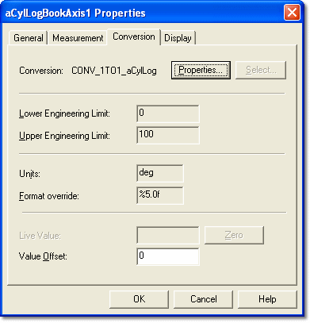
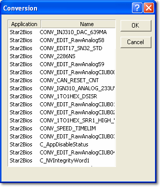

# Parameter Properties – Conversion tab

Conversion is the process by which the raw data in the ECU is converted to an easily readable engineering format for display. Conversions are defined separately from parameters and have their own names. The Conversion tab of the Parameter Properties dialog box is available for all parameters except Live Auto Tune parameters.

The properties are defined by the ECU manufacturer in the ASAP file and are read only. However, the ASAP file can be modified to make the properties of a Measurement Parameter editable in System Monitor.

| Control | Description |
|---|---|
| **Conversion** | The name of the conversion applied to the parameter. |
| **Properties** | Opens the [Conversion Properties](conversions/conversion-properties.md) dialog box. |
| **Select** | Opens the Conversion dialog box, where you can select a conversion to apply to the Parameter. Available only if the conversion of the parameter can be edited, and always available for Virtual Parameters. |
| **Lower Engineering Limit** / **Upper Engineering Limit** | For an Editable Parameter, the minimum and maximum engineering values that you can enter during Tuning. For a Measurement Parameter, the minimum and maximum engineering values displayed in an Oscilloscope or Bar Graph Window. |
| **Units** | The symbol or text that indicates the units used. Units can be edited here only for Virtual, CAN and External Inputs parameters; for other parameters, the units come from the conversion and are changed in [Conversion Properties](conversions/conversion-properties.md). For a Virtual Parameter, units entered here override the units of the conversion for that parameter only. |
| **Format override** | Overrides the number format used to display the parameter. The syntax is described in [Number Formats](number-formats.md). |
| **Live Value** | The live value of the selected Parameter. |
| **Zero** | Sets the Live Value to zero. The **Value Offset** box then shows the offset required to convert the Live Value to zero, and you are asked whether to accept the zero offset changes. Available only when System Monitor is online. |
| **Value Offset** | A value by which to offset the Live Value of the Parameter displayed in a Window. |

The **Live Value**, **Zero** and **Value Offset** controls are shown for Measurement Parameters only, and only when **Zero Offset Sampling Time (ms)** in [Advanced Settings](../../settings.md) is greater than 0 (default 5000). **Zero** and **Value Offset** are enabled by the **Enable Parameter Offset (Y/N)** setting.

In the Conversion dialog box opened by **Select**, the list shows the **Application**, **Name** and **Type** of each conversion. Use the **Filter** box to find a conversion, select it and click **OK**.

!!! note
    A zero offset can be applied to the Measurement Parameters in all Windows on a page by selecting **Desktop** > **Page** > **Zero All Measurements** (ALT+SHIFT+Z). Select **Desktop** > **Page** > **Clear All Display Offsets On Page** (ALT+SHIFT+D) to remove them.

**See also:** [Conversion Properties](conversions/conversion-properties.md); [Editable Parameters](../editable-parameters.md); [Measurement Parameters](../measurement-parameters.md); [Number Formats](number-formats.md); [Tuning](../../../tuning/index.md)
