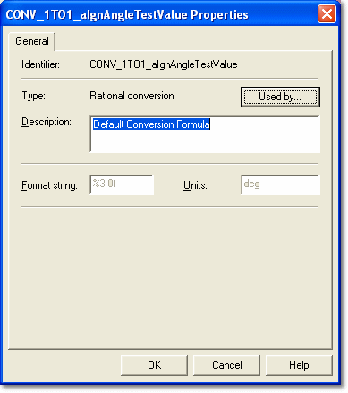

# Conversion Properties

Conversion is the process by which the raw data in the ECU is converted to an easily readable engineering format for display. Conversions are defined separately from parameters and have their own names.

To open the Conversion Properties dialog box, click **Properties** on the Conversion tab of the [Parameter Properties](../conversion-tab.md) dialog box.

The properties are defined by the ECU manufacturer in the [ASAP](../../../../project-management/asap-compatibility.md) file and are read only here. However, the ASAP file can be modified to make the properties of a [Measurement Parameter](../../measurement-parameters.md) editable in System Monitor.

The dialog box has two parts. The upper part, described here, is common to all types of conversion. The lower part is specific to each type of conversion and is described in the following topics.

| Control | Description |
|---|---|
| **Identifier** | The unique name of the conversion. |
| **Type** | The type of conversion: [Rational](rational-conversion.md), [Formula](formula-conversion.md), or [Table or Text](table-conversion.md). The type cannot be changed. |
| **Used by...** | Opens a list of the Parameters that use the conversion, to help you determine the effect of a change. |
| **Description** | Free text for a description of the conversion. |
| **Format string** | Defines the way numbers are displayed. The syntax is described in [Number Formats](../number-formats.md). |
| **Units** | The symbol or text that indicates the units used. |

**See also:** [Parameter Properties – Conversion tab](../conversion-tab.md); [Rational Conversion](rational-conversion.md); [Formula Conversion](formula-conversion.md); [Table Conversion](table-conversion.md)
