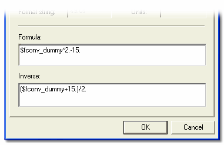

# Formula Conversion

A Formula conversion is defined by two free-text expressions in the lower part of the dialog box. The syntax and operators available for writing formulae are explained in [Mathematical Operators](../mathematical-operators.md).

| Control | Description |
|---|---|
| **Formula** | Converts the **Raw** data to the **Engineering** value. |
| **Inverse** | Converts an **Engineering** value back to **Raw** data. The inverse is required when the conversion is used by an [Editable Parameter](../../editable-parameters.md). It is not generated automatically. |

Formula conversions are defined in the ASAP file (FORMULA and FORMULA_INV, with X1 representing the input value). The **Formula** and **Inverse** are shown in System Monitor, but changes made to them are not saved.

**See also:** [Conversion Properties](conversion-properties.md)
