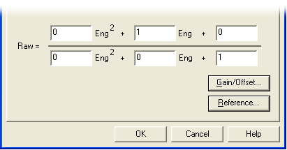
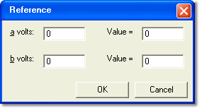

# Rational Conversion

The structure of the formula in the lower part of the Rational Conversion dialog box is defined by the [ASAP2](../../../../project-management/asap-compatibility.md) specification:

Raw = (a × Eng² + b × Eng + c) / (d × Eng² + e × Eng + f)

Enter the six coefficients in the boxes.

The inverse equation (which converts **Raw** data to **Engineering** values) is generated automatically by System Monitor. The result is checked to ensure that it is not a complex number and that the solution is within the range of the raw value's data type.

The equation (1 × Eng) / 1 is used when no conversion is required, that is when the **Raw** value is the same as the **Engineering** value. This is the default conversion given to a new Virtual Parameter.

## Gain/Offset and DAMOS conversions

These two conversion types are subsets of the rational conversion formula. The coefficients can be calculated for you:

- Click **Gain/Offset...** to open the Gain & Offset dialog box. Enter the **Gain (Eng/Volt)** and **Offset (Eng)** and click **OK**.
- Click **Reference...** to open the Reference dialog box. Enter two voltages (**a volts** and **b volts**) and the engineering **Value** associated with each, and click **OK**.

    

The rational conversion coefficients are calculated automatically from the values you enter.

**See also:** [Conversion Properties](conversion-properties.md)
