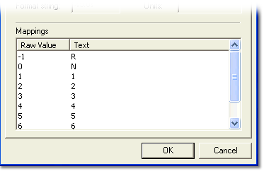

# Table Conversion

The lower part of a table-based conversion dialog box contains a list of **Mappings** between the raw data and the engineering value. To edit the list, move to a mapping value and enter a new value. A raw value cannot be entered more than once; if it is, the message *Incorrect input type or duplicate data* is shown.

There are two table-based conversion types:

- **Table** – maps raw values to numeric engineering values. Select **Interpolate between values** to calculate engineering values between the mapped raw values.
- **Text** – maps raw values to text. The mapping always has a **Default** entry. This text is displayed when the raw value does not match any value in the mapping.

**See also:** [Conversion Properties](conversion-properties.md)
