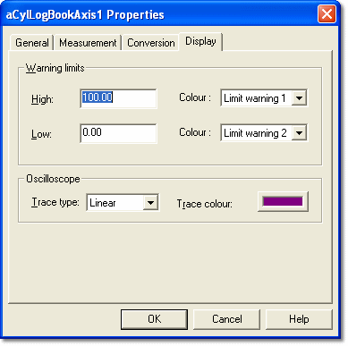

# Parameter Properties – Display tab

The Display tab of the Parameter Properties dialog box is available for Measurement and Virtual parameters only.

For ECU parameters, the settings on this tab are stored in the Desktop File and can only be edited when a Desktop is open. For Virtual Parameters, they are stored in the Virtual Parameter file.

When you change the Display properties of a parameter, the changes appear in every window that contains the parameter.

## Warning limits panel

The value of a Measurement parameter in Numeric, Grid and Bar Graph Windows is shown in a colour that indicates its status. The colour changes, as a warning, when the value is outside its normal operating range. The colours are set for each Window on the Display tab of the Window Properties dialog box. Two colour definitions are available: **Limit warning 1** and **Limit warning 2**.

| Control | Description |
|---|---|
| **High** | The engineering value of the high warning limit. |
| **Low** | The engineering value of the low warning limit. |
| **Colour** | The colour definition (**Limit warning 1** or **Limit warning 2**) used when the value passes the limit. The defaults are Limit warning 1 for High and Limit warning 2 for Low. |

The default limit values are the Lower and Upper Engineering Limits for the Parameter, as set on the [Conversion tab](conversion-tab.md) of the Parameter Properties dialog box. The low limit cannot be greater than the high limit.

To show all out-of-range values in the same colour, assign the same colour definition to both limits.

## Oscilloscope panel

When a Measurement parameter is displayed in an Oscilloscope Window, the display uses the settings in the Oscilloscope panel:

| Control | Description |
|---|---|
| **Trace type** | The type of trace used to display the parameter: **Linear** (default), **Digital** or **Logical**. See [Oscilloscope – Types of Trace](../../../data-display/oscilloscope-display/oscilloscope-types-of-trace.md). |
| **Trace colour** | Click the colour button to [select a colour](selecting-a-colour.md) for the trace line. By default, each parameter is given a colour from a set of twelve trace colours. |

**See also:** [Data Display](../../../data-display/index.md); [Oscilloscope](../../../data-display/oscilloscope-display/oscilloscope.md); [Oscilloscope – Types of Trace](../../../data-display/oscilloscope-display/oscilloscope-types-of-trace.md); [Parameter Properties](index.md)
