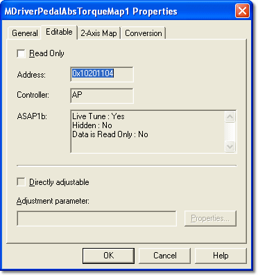

# Parameter Properties – Editable tab

The Editable tab of the Parameter Properties dialog box is available for all Editable Parameters. The properties are defined by the ECU manufacturer in the [ASAP](../../../project-management/asap-compatibility.md) file and are read only here.

| Control | Description |
|---|---|
| **Read Only** | Indicates an editing restriction placed on the parameter by the ECU manufacturer. When selected, the values cannot be changed. See [Changing Parameter Values](../../../tuning/changing-parameter-values/index.md). |
| **Address** | The location of the parameter in [ECU memory](../../../ecu-control/ecu-memory/index.md). |
| **Controller** | The ECU controller that holds the parameter. |
| **ASAP1b** | Information about the Parameter in the ASAP file. |
| **Directly adjustable** | When selected, the parameter can be modified directly using the [Adjustment Board](../../../hardware/adjustment-board.md). |
| **Adjustment parameter** | The name of the [Adjustment Parameter](../../../tuning/adjustment-board-control/adjustment-board-configuration.md) used by the Editable Parameter. |
| **Properties** | Opens the properties of the Adjustment Parameter, including its [Adjustment](adjustment-tab.md) tab. |

**See also:** [Tuning](../../../tuning/index.md); [Adjustment Board Control](../../../tuning/adjustment-board-control/adjustment-board-control.md)
