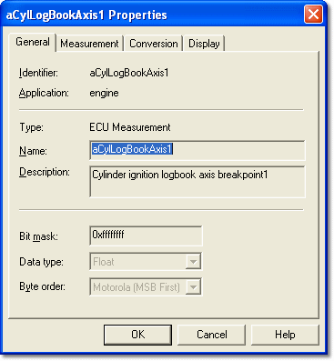

# Parameter Properties – General tab

The General tab of the Parameter Properties dialog box is available for all Parameters. The properties are defined by the ECU manufacturer in the ASAP file and are read only here. However, the ASAP file can be modified to make the properties of a Measurement Parameter editable in System Monitor.

| Control | Description |
|---|---|
| **Identifier** | See [Names, Descriptions and Groups](../names-descriptions-and-groups.md). |
| **Application** | The Application that the parameter belongs to. Unavailable for parameters that are not part of an Application. |
| **Type** | The parameter type, for example *Scalar*. |
| **Name** / **Description** | See [Names, Descriptions and Groups](../names-descriptions-and-groups.md). |
| **Bit mask** / **Data type** / **Byte order** | Information for development teams. **Data type** is one of Unsigned Byte, Signed Byte, Unsigned Word, Signed Word, Unsigned Long, Signed Long, Unsigned Long Long, Signed Long Long, Float, Double or Unknown. **Byte order** is Motorola (MSB First) or Intel (MSB Last). |

You can edit the **Name** and **Description** of a [Virtual Parameter](../virtual-parameters/index.md) and of a parameter created by External Inputs Configuration. The **Identifier** of a Virtual Parameter can also be edited.

**See also:** [External Inputs Configuration](../../../data-acquisition/sensors/external-inputs/external-inputs-configuration.md)
