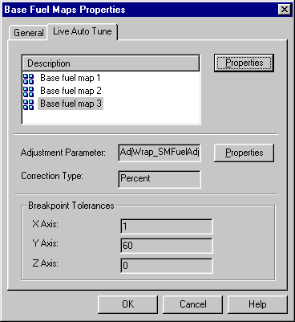

# Parameter Properties - Live Auto Tune tab

The Live Auto Tune tab of the Parameter Properties dialog box is available for Live Auto Tune parameters only. A Live Auto Tune parameter has only the General and Live Auto Tune tabs. The information on this tab is read only.

| Control | Description |
|---|---|
| Map list | The maps included in the Live Auto Tune Parameter. Click **Properties** to view the Parameter Properties for the selected map. |
| **Adjustment Parameter** | The name of the Adjustment Parameter used to tune the selected value. Click **Properties** to view its Parameter Properties. |
| **Correction Type** | How the Adjustment Parameter is applied to the selected value: **Multiply**, **Add**, **Percent** or **Replace**. |
| **Breakpoint Tolerances** | The breakpoint tolerances for the **X Axis**, **Y Axis** and **Z Axis**. See [Live Auto Tune](../../../tuning/live-auto-tune.md). |

**See also:** [Live Auto Tune](../../../tuning/live-auto-tune.md)
