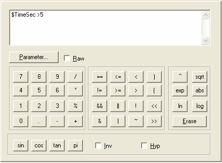

# Mathematical Operators

Virtual Parameters, Live Logging Trigger Conditions and Alarm Triggers are each defined by a formula in which one or more Parameters are combined with mathematical operators.

The formula for a Virtual Parameter must result in a value, while the formula for a Live Logging Trigger Condition or an Alarm Trigger must result in a logical condition (TRUE or FALSE).

You can type the formula directly into the edit box but, for convenience, there are buttons for the digits, the decimal point and all the operators.

## Adding Parameters

To add a Parameter to the formula, click **Parameter...** to open the Select Parameter dialog box and select a Parameter. Alternatively, type the parameter name directly into the edit box, preceded by a **$** symbol (for example `$NEngine`).

If **Raw** is selected when you click **Parameter...**, the parameter is inserted with a **$$** prefix and the raw value of the parameter is used in the formula instead of the engineering value.

## NoLog

Parameters added to a Virtual Parameter can be wrapped in the `NoLog()` function, for example `NoLog($NEngine)`. The parameter is then logged only as slow row, unless it is explicitly added to the Logging Configuration or used in another Virtual Parameter.

## Features

- **Inv** – when selected, the sin, cos and tan buttons insert their inverses (asin, acos, atan).
- **Hyp** – when selected, the sin, cos and tan buttons insert their hyperbolic equivalents (sinh, cosh, tanh). Inverses of hyperbolic functions are not available, so selecting one of **Inv** and **Hyp** clears the other.
- Angles are in **radians**.
- Functions (sin, cos, tan, exp, sqrt, abs, ln, log and their inverse and hyperbolic equivalents) take their argument in parentheses, for example `sqrt($Pressure)`.
- The **min** and **max** buttons insert `min( , )` and `max( , )`. Enter two values separated by a comma.
- **Erase** clears the edit box.
- The syntax is checked when you click **OK**.

## Operators

| Operator | Meaning | Operator | Meaning |
|---|---|---|---|
| `+` | Add | `sin()` | Sine |
| `-` | Subtract | `asin()` | Inverse sine (arc sine) |
| `*` | Multiply | `sinh()` | Hyperbolic sine |
| `/` | Divide | `cos()` | Cosine |
| `%` | Modulus (remainder) | `acos()` | Inverse cosine (arc cosine) |
| `^` | Power | `cosh()` | Hyperbolic cosine |
| `( )` | Parentheses | `tan()` | Tangent |
| `==` | Equal to | `atan()` | Inverse tangent (arc tangent) |
| `!=` | Not equal to | `tanh()` | Hyperbolic tangent |
| `<` | Less than | `sqrt()` | Square root |
| `>` | Greater than | `exp()` | Exponential (e to the power of the value) |
| `<=` | Less than or equal to | `abs()` | Absolute value |
| `>=` | Greater than or equal to | `ln()` | Logarithm to base e |
| `&&` | Logical AND | `log()` | Logarithm to base 10 |
| `\|\|` | Logical OR | `min( , )` | Smaller of two values |
| `!` | Logical NOT | `max( , )` | Larger of two values |
| `&` | Bitwise AND | `pi` | Constant 3.14159… |
| `\|` | Bitwise OR | `<<` | Left shift |
| `~` | Bitwise NOT | `>>` | Right shift |

**See also:** [Alarm Properties – Trigger](../../../data-display/other-displays/alarms/alarm-properties-trigger.md); [Live Logging](../../../data-acquisition/logging/live-logging/index.md); [Live Logging Trigger Conditions](../../../data-acquisition/logging/live-logging/trigger-condition-tab.md); [Virtual Parameters](../virtual-parameters/index.md)
