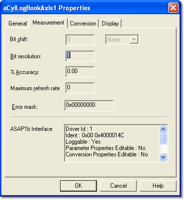

# Parameter Properties – Measurement tab

The Measurement tab of the Parameter Properties dialog box is available for Measurement and Virtual parameters only.

The properties are defined by the ECU manufacturer in the ASAP file and are read only here. However, the ASAP file can be modified to make the properties of a Measurement Parameter editable in System Monitor.

All the properties of a Virtual Parameter, and of a parameter created by External Inputs Configuration, can be edited, except the ASAP1b Interface Data.

| Control | Description |
|---|---|
| **Bit shift** | The number of bits by which the raw value is shifted, and the shift direction (**None**, **Left** or **Right**). The number of bits can only be entered when a direction is selected. |
| **Bit resolution** | The smallest possible change, in bits, of the parameter value. |
| **% Accuracy** | The possible variation between the displayed value and the real value, as a percentage. |
| **Maximum refresh rate** | The time required to acquire the parameter value. The units are shown after the value, for example milliseconds, or an angle-based unit such as degrees or revolutions. |
| **Error mask** | Mask used to identify whether the Parameter is in error. |
| **ASAP1b Interface Data** | Information about the Parameter in the ASAP file. |

**See also:** [Errors](../../../data-display/other-displays/errors/index.md)
