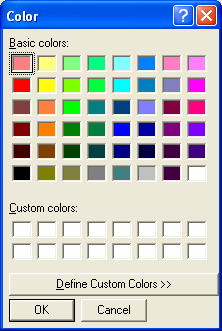
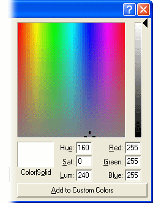

# Selecting a Colour

To open the Color dialog box, click the colour button on the Display tab of the [Window Properties](../../windows/using-windows/window-properties-display-tab.md) dialog box or the [Parameter Properties](display-tab.md) dialog box.

Click a colour block and click **OK** (or double-click the block) to select the colour. The selected colour is shown on the colour button.

If the colour you want is not among the **Basic colors**, click **Define Custom Colors**. The dialog box expands to show the custom colour options.

## Define Custom Colours

To create a custom colour:

1. Click in the colour palette, or enter a set of values for either:
    - **Red**, **Green** and **Blue**, or
    - **Hue**, **Sat** (saturation) and **Lum** (luminosity).
2. Click **Add to Custom Colors** to place the colour in the **Custom colors** grid, where it can be selected in the same way as a basic colour.

**See also:** [Window Properties – Display tab](../../windows/using-windows/window-properties-display-tab.md); [Parameter Properties – Display tab](display-tab.md)
