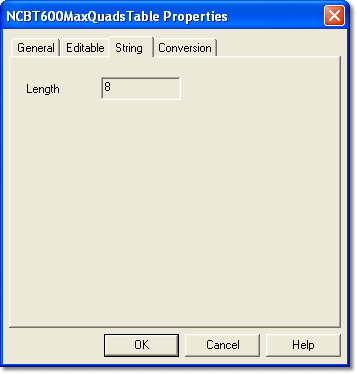

# Parameter Properties – String tab

The **String** tab of the [Parameter Properties](index.md) dialog box is available for [String](../../../tuning/string-window.md) parameters only. The properties are defined by the ECU manufacturer in the [ASAP](../../../project-management/asap-compatibility.md) file and are read only here.

**Length** – the maximum number of characters in the String.

**See also:** [String](../../../tuning/string-window.md)
