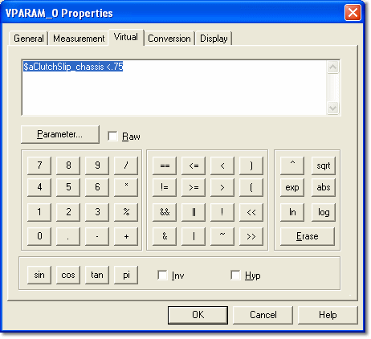

# Parameter Properties – Virtual tab

The Virtual tab of the Parameter Properties dialog box is available for Virtual parameters only. Use it to define or edit the formula of the Virtual Parameter. It opens automatically when you [create a Virtual Parameter](../virtual-parameters/creating-a-virtual-parameter.md).

The formula, the buttons on this tab and the syntax are described in [Mathematical Operators](mathematical-operators.md). An expression must be entered, and it is checked for errors when you click **OK**.

**See also:** [Creating a Virtual Parameter](../virtual-parameters/creating-a-virtual-parameter.md); [Mathematical Operators](mathematical-operators.md); [Virtual Parameters](../virtual-parameters/index.md)
