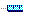
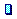
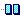
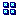
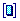
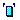
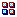
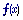

# Parameter Symbols

Each Parameter type is identified by an icon:

| Symbol | Parameter type |
|---|---|
|  | [Measurement Parameter](measurement-parameters.md) |
|  | [Scalar Editable Parameter](../../tuning/scalar-window.md) |
|  | [1-axis Map Editable Parameter](../../tuning/1-axis-map-window/1-axis-map.md) |
|  | [2-axis Map Editable Parameter](../../tuning/2-axis-map-window.md) |
|  | [Array Editable Parameter](../../tuning/array-window.md) |
|  | [String Editable Parameter](../../tuning/string-window.md) |
|  | [Live Auto Tune](../../tuning/live-auto-tune.md) |
|  | [Virtual Parameter](virtual-parameters/index.md) |
|  | [Locked Parameter](locked-parameters/locked-parameters.md) – the Parameter icon is overlaid with a lock (a Measurement Parameter is shown). The Parameter is locked and cannot be edited or added to the Desktop. |

These symbols are displayed in:

- Parameter Explorer
- the Select Parameter(s) dialog boxes
- the Data Wizard Report View and Candidate View

**See also:** [Data Wizard](../../project-management/data-wizard/index.md); [Parameters](index.md); [Parameter Explorer](parameter-explorer.md)
