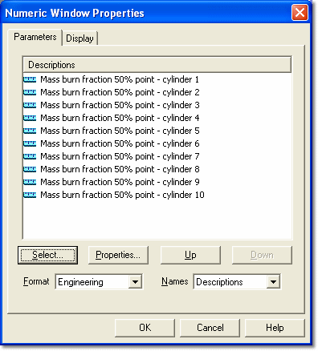

# Multiple Parameter Selection – Window Properties

To load one or more Parameters into a Window that accepts multiple Parameters, open the Window Properties dialog box for the Window and select the **Parameters** tab.

The Parameters tab lists the Parameters shown in the Window. The type of each Parameter is indicated by its [Symbol](../parameter-symbols.md).

| Control | Description |
|---|---|
| **Select...** | Opens the [Select Parameters](selecting-multiple-parameters.md) dialog box, where you add or remove Parameters. |
| **Properties...** | Opens the Parameter Properties dialog box for the selected Parameter. |
| **Up** / **Down** | Selects the Parameter above or below the currently selected one. You can also select Parameters with the mouse, the UP and DOWN arrow keys, or PAGE UP and PAGE DOWN. |
| **Format** | How the Parameters are displayed in the Window (see below). |
| **Names** | How the Parameters are identified in the Window (see below). |

Click **OK** to apply the changes.

## Format options

- **Engineering** – values are displayed using the format and [conversion](../parameter-properties/conversions/conversion-properties.md) defined in the Parameter Properties.
- **Raw hexadecimal** – the raw data in the ECU is displayed as hexadecimal numbers, not converted to engineering values.
- **Raw binary** – the raw data is displayed as binary numbers.
- **Raw decimal** – the raw data is displayed as decimal numbers.
- **Address** – the memory location of the value is shown in hexadecimal instead of the value.
- **Graphical** – see [Graphical View – 1 axis](../../../tuning/graphical-maps/graphical-view-1-axis.md).
- **Difference** – see [Difference View](../../../tuning/graphical-maps/difference-view.md).

The options available depend on the type of Window:

| Window | Format options |
|---|---|
| 1-axis Map | Engineering, Raw hexadecimal, Address, Graphical, Difference (Engineering and Raw hexadecimal only in a compare view) |
| Oscilloscope, Bar Graph | Engineering, Raw hexadecimal, Raw binary |
| Other Windows, for example Numeric and Scalar | Engineering, Raw hexadecimal, Raw binary, Raw decimal |

## Names options

- **Names** – only the Parameter Name is shown.
- **Descriptions** – only the Parameter Description is shown.
- **Both** – both the Parameter Name and the Parameter Description are shown.
- **None** – no identifier is shown; the [Units](../parameter-properties/conversions/conversion-properties.md) text is shown instead. In a [Numeric](../../../data-display/numeric-display/numeric.md) Window, the column is closed.

A Bar Graph Window offers Name, Description and None; an Oscilloscope Window offers Name and Description.

**See also:** [Selecting Multiple Parameters](selecting-multiple-parameters.md); [Window Properties](../../windows/using-windows/window-properties.md)
