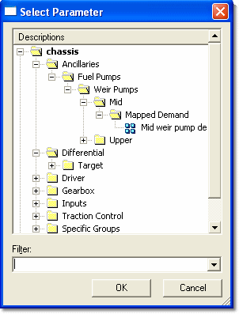

# Selecting a Single Parameter

To open the Select Parameter dialog box, open the Window Properties dialog box, select the **Parameter** tab and click **Select...**.

!!! note
    This dialog box is also used to select a Parameter for a cell in a Grid Window, to select a Parameter when creating a formula for Live Calibration, and by **Parameter...** in the formula editor (see [Mathematical Operators](../parameter-properties/mathematical-operators.md)).

The list in the Select Parameter dialog box includes all the Parameters of the appropriate type for the Window. The type of each Parameter is indicated by its [Symbol](../parameter-symbols.md).

Use the [Filter](parameter-filter.md) to help you locate the Parameters you want.

If necessary, change the column width: place the mouse pointer on the right border of the column header so that the resize cursor  appears, then drag the column to a new width.

To select a Parameter, select it and click **OK**, or double-click it.

**See also:** [Single Parameter Selection – Window Properties](single-parameter-selection-window-properties.md)
