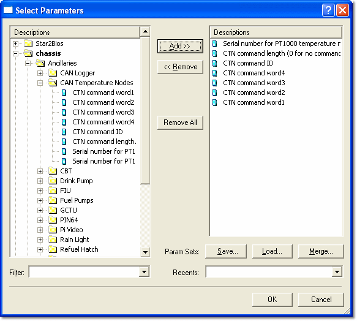

# Selecting Multiple Parameters

To open the Select Parameters dialog box, open the Window Properties dialog box, select the **Parameters** tab and click **Select...**.

!!! note
    This dialog box is also used to select parameters in the Candidate Version Window and the Report View Window of Data Wizard, and to [edit the Parameter Unlock List](../locked-parameters/edit-the-parameter-unlock-list.md).

The dialog box has two lists:

- **Parameters** – the left-hand list shows all the Parameters of the appropriate type for the Window.
- **Selected Parameters** – the right-hand list shows the Parameters that will be displayed in the Window.

The type of each Parameter is indicated by its [Symbol](../parameter-symbols.md). Each list has its own [Filter](parameter-filter.md) box.

To add Parameters:

1. Select the Parameters that you want to add in the Parameters list. CTRL+click to select multiple Parameters. Use the Filter to help you locate the Parameters you want.
2. Click **Add >>** to move the selected Parameters to the Selected Parameters list. If a Group is selected, all the Parameters in the Group are added. You can also drag selected Parameters or Groups to the right-hand list, or double-click a single Parameter to add it.
3. Click **OK**.

To remove Parameters:

1. Select the Parameters that you want to remove in the Selected Parameters list.
2. Click **<< Remove** or press DELETE. You can also drag selected Parameters to the left-hand list, or double-click a single Parameter to remove it. Click **Remove All** to remove all the Parameters from the Selected Parameters list.
3. Click **OK**.

## Parameter Sets

Use the **Param Sets** buttons to save, load and merge the Parameters in the Selected Parameters list.

| Control | Description |
|---|---|
| **Save...** | Opens the Save Parameter Set dialog box. Saves the Parameters listed as a Parameter Set (`.pms`) file. |
| **Load...** | Opens the Load Parameter Set dialog box. Select a previously saved Parameter Set to load it into the Selected Parameters list. Parameters already in the list are removed. |
| **Merge...** | Opens the Load Parameter Set dialog box. Select a previously saved Parameter Set to merge it with the Parameters already in the Selected Parameters list. |
| **Recents** | Lists recently used Parameter Sets. Select one to load it into the Selected Parameters list, replacing the Parameters already in the list. |

**See also:** [Multiple Parameter Selection – Window Properties](multiple-parameter-selection-window-properties.md)
