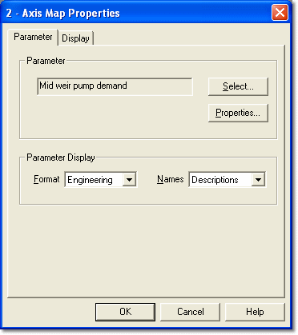

# Single Parameter Selection – Window Properties

To load a Parameter into a Window that accepts a single Parameter, open the Window Properties dialog box and select the **Parameter** tab.

## Parameter panel

The Parameter panel shows the Parameter that is shown in the Window, with its [Symbol](../parameter-symbols.md).

| Control | Description |
|---|---|
| **Select...** | Opens the [Select Parameter](selecting-a-single-parameter.md) dialog box, where you select the Parameter. |
| **Properties...** | Opens the Parameter Properties dialog box for the Parameter. |

## Parameter Display panel

**Format** – how the Parameter is displayed in a [2-axis Map](../../../tuning/2-axis-map-window.md) Window:

- **Engineering** – values are displayed using the format and [conversion](../parameter-properties/conversions/conversion-properties.md) defined in the [Parameter Properties](../parameter-properties/index.md).
- **Raw hexadecimal** – the raw data in the ECU is displayed as hexadecimal numbers, not converted to engineering values.
- **Raw decimal** – the raw data is displayed as decimal numbers.
- **Address** – the memory location of the value is shown in hexadecimal instead of the value.
- **Graphical** – see [Graphical View – 2 axis](../../../tuning/graphical-maps/graphical-view-2-axis.md).
- **Difference** – see [Difference View](../../../tuning/graphical-maps/difference-view.md).
- **End view** – see [End View](../../../tuning/graphical-maps/end-view.md).

In a compare view, only Engineering, Raw hexadecimal and Raw decimal are available.

**Names** – how the Parameter is identified in the Window:

- **Names** – only the Parameter Name is shown.
- **Descriptions** – only the Parameter Description is shown.
- **Both** – both the Parameter Name and the Parameter Description are shown.

Click **OK** to apply the settings and close the dialog box.

**See also:** [Selecting a Single Parameter](selecting-a-single-parameter.md); [Window Properties](../../windows/using-windows/window-properties.md)
