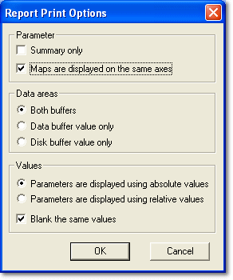

# Data Wizard Print Options

The Report Print Options dialog box controls the appearance of the printout of a Data Wizard Candidate Version or Report View.

The Report Print Options dialog box opens automatically when:

- a Candidate Version window is printed, or
- [View Differences](../../project-management/data-wizard/data-wizard-view-parameter.md) is used.

It can also be opened by selecting **Print Setup...** on the [Data Wizard Menu](../menus/data-wizard-menu.md).

## Parameter

- **Summary only** - When selected, only a summary is printed. All the other options are unavailable.
- **Maps are displayed on the same axes** - When selected, each row of a map contains the parameter values for the current Data Version with the values for the Candidate Version directly below. When not selected, a separate map is printed for each set of values.

## Data areas

These options are available for a Report View:

- **Both buffers** - The printout includes Parameter values from the Data buffer and the Disk buffer.
- **Data buffer value only** - The printout includes Parameter values from the Data buffer only.
- **Disk buffer value only** - The printout includes Parameter values from the Disk buffer only.

## Values

The absolute values of the current Data Version are always shown. These options are available when **Both buffers** is selected:

- **Parameters are displayed using absolute values** - The Candidate Version values are also shown as absolute values.
- **Parameters are displayed using relative values** - The differences between the Candidate Version and the current version values are shown.
- **Blank the same values** - When selected, a space is left where the Candidate Version value is the same as the current version (or where the relative value is zero). When not selected, the value is shown. Only available when **Maps are displayed on the same axes** is also selected.

**See also:** [Data Wizard – Candidate Version](../../project-management/data-wizard/data-wizard-candidate-version.md); [Printing Data Wizard Windows](printing-data-wizard-windows.md)
