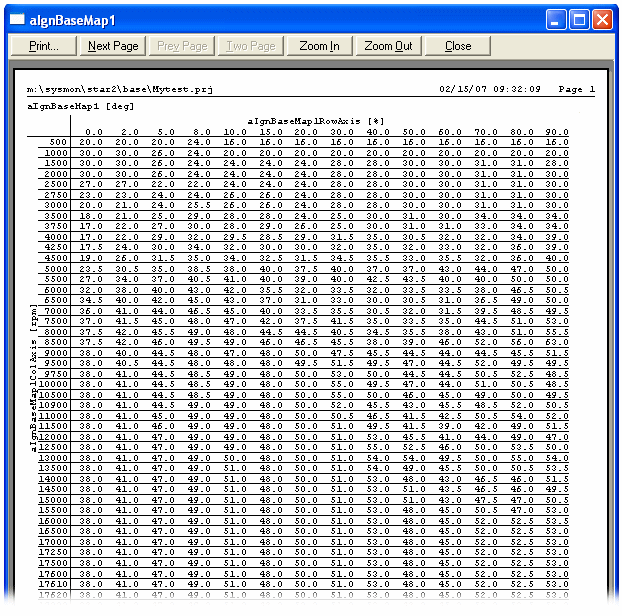

# Print Preview

Preview the printout of the contents of Windows as follows:

- **To preview the selected Window only** - Select **File** > **Print Preview...**.
- **To preview all the Windows on the current Page** - Select **Desktop** > **Page** > **Print Preview...**.

Print Preview also opens automatically when you use View Differences in Data Wizard.

The Print Preview screen has the following controls:

- **Print** - Prints the page using the settings in Print Setup.
- **Next Page** - Displays the next page.
- **Prev Page** - Displays the previous page.
- **One Page / Two Page** - Toggles the display between one and two pages.
- **Zoom In** - Enlarges the view.
- **Zoom Out** - Reduces the view.
- **Close** - Closes Print Preview and returns to System Monitor.

Zoom operates in three steps. Clicking the left mouse button on the page cycles through the Zoom In steps and back to the full page; the view is centred on the mouse pointer. If the Two Page view is selected, the first Zoom In step changes the view to One Page.

!!! warning
    Do not use  to close Print Preview, as this closes System Monitor. Use the **Close** button.

**See also:** [Printer Support](printer-support.md)
