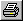

# Printing Data Wizard Windows

To print the contents of a Report View or a Candidate Data Version window:

1. Select the Window.
2. Select **File** > **Print...** or click .

The printout shows all the parameters listed in the selected Window. The format for each parameter is as described in [Printer Support](printer-support.md). The appearance of the printout is set in the [Report Print Options](data-wizard-print-options.md) dialog box.

For Candidate Data Version windows, the parameter values are shown for both the Candidate Version and the current version.

**See also:** [Candidate Data Version View](../../project-management/data-wizard/data-wizard-candidate-version.md); [Data Wizard Print Options](data-wizard-print-options.md); [Printer Support](printer-support.md); [Report View](../../project-management/data-wizard/data-wizard-report-view.md)
