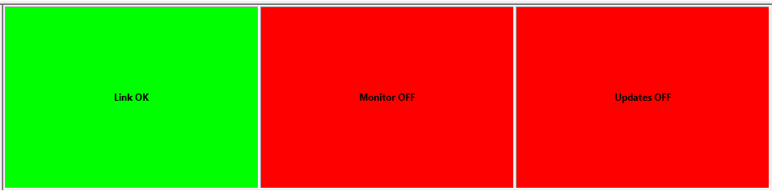

# Comms Bar

To show, hide or move the Comms Bar see [Tool and Information Bars](index.md).

The Comms Bar has three indicators. From left to right these are:

## Link Status

The status of the ECU connection:

| Text | Meaning | Background |
|---|---|---|
| **Link OK** | The connection to the ECU is working and the ECU can be placed On-Line. | Green |
| **In Boot** | The ECU controllers are in Boot mode (Zone 0). | Yellow |
| **Zone 1**, **Zone 2**, **Zone 3** | The ECU controllers are in that zone. | Green |
| **Link NOK** | No ECU, or the wrong type of ECU, is connected, or the link or the ECU is not working correctly. The ECU cannot be placed On-Line. | Red |
| **No link**, **Ctrlr Busy**, **Bad RESP**, **Invalid Device** | There is no link, the controller is busy, the ECU gave a bad response, or the device is invalid. | Red |

When no unit is selected, the bar shows **No unit**. When the Project uses two units, a Link Status indicator is shown for each.

## System Monitor Status

The status of the ECU:

- **Monitor OFF** - The ECU is Off-Line. Background red.
- **Monitor ON** - The ECU is On-Line. Background green, or yellow if any Program Version in the ECU is different from the corresponding one in the Project.

## Live Tune Status

The status of Live Tune:

- **Updates OFF** - Changes to [Editable Parameters](../parameters/editable-parameters.md) are stored in the [Edit Buffer](../../project-management/developing-data-versions/index.md) but not sent to the ECU. Background red.
- **Updates ON** - Changes to Editable Parameters are stored in the Edit Buffer and immediately sent to the ECU. Background green.

When a modem is enabled (see [Standard Tool Bar](standard-tool-bar.md)), this indicator shows **Modem:** followed by the status of the link to the modem server instead. The background is pale blue when the modem link is OK and red otherwise.

**See also:** [ECU Control](../../ecu-control/index.md); [Extended Comms Bar](extended-comms-bar.md); [Live Tune](../../tuning/live-tune.md)
