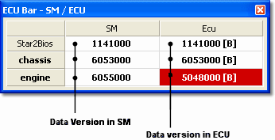

# ECU Bar

The default location for the ECU Bar is docked at the top of the Main Window. To show, hide or move the Bar see [Tool and Information Bars](index.md).

For each Application the ECU Bar shows:

- **SM** column - the file name of the Data Version currently loaded into System Monitor.
- **Ecu** column - the file name of the Data Version currently loaded into the ECU. If System Monitor cannot locate the Data Version file, the Program Version number from the ECU is displayed.

There is also a **Remote** row, which shows the remote logging configuration file currently loaded into System Monitor and into the ECU.

Active Applications are shown in bold text. When changes have been made to the Data Version in System Monitor, the background colour of the ECU Data Version changes to red to indicate that the Data Versions do not match.

The following symbols may also appear:

| Symbol | Meaning |
|---|---|
| **(\*)** | The version has been modified and not yet saved. |
| **?** or **(?)** | System Monitor is unable to obtain the information from the ECU. |
| **(L)** | The Data Version is locked with standard RDA. |
| **(L2)** | The Data Version is locked with enhanced RDA 2. |

If the Advanced Setting **Enable FIA lock checking** is **Y** and the unit is FIA-locked, the Data Version in the SM column is highlighted if it is not a permitted version.

## File names in shortened form

The file name can be shown in a shortened form. If **Format data version text** is set to **Y** in the [Advanced Settings](../settings.md), the ECU Bar displays a string of hex characters extracted from the name instead of the full name. The hex string is created by reading the file name from right to left, adding hex characters until a non-hex character is found or the string reaches 7 characters.

## Search status

See [ECU Search](../../ecu-control/ecu-search/index.md) for a description of how System Monitor finds the information to display.

The background colour of the SM and Ecu columns shows the status of the search:

- **Green** - The search is in progress.
- **Yellow** - Searching is blocked by another function such as [Programming](../../ecu-control/ecu-memory/reprogramming-the-ecu.md).

## Context menu

Right-click the ECU Bar to open its context menu:

| Command | Description |
|---|---|
| **Basic Mode** | Switches the ECU Bar to Basic Mode (see below). In Basic Mode the menu contains only **Advanced Mode**, which switches back. |
| **Connections...** | Opens the [Connections](../../project-management/projects/properties/connections.md) dialog box. |
| **Unit Status** | Opens the [Unit Status](../../ecu-control/unit-status.md) dialog box. |
| **Hide Header** / **Show Header** | Hides or shows the column headings. |
| **Active Application** | Makes the Application the [Active Application](../../project-management/active-application.md). |
| **Application Read Only** | Makes the Application Read Only. |
| **Hide Application** | Hides the Application in the ECU Bar. |
| **Hide Row Data** | Hides the row data for the Application. |
| **Download Data Changes** | See [Downloading Data to the ECU](../../ecu-control/data-changes-in-the-ecu/downloading-data-to-the-ecu.md). |
| **Reprogram Application** | See [Reprogramming the ECU](../../ecu-control/ecu-memory/reprogramming-the-ecu.md). |
| **Force Reprogram Application** | See [Force Complete Reprogram](../../ecu-control/ecu-memory/force-complete-reprogram.md). |

## Basic Mode

In Basic Mode the ECU Bar shows a single status for the combined status of the Project's Application and configuration files: **Unit Sync OK** (green) or **Unit Sync NOK** (red). Unit Sync NOK is also shown when the link to the unit is not OK.

**See also:** [Advanced Settings](../settings.md); [Data Versions](../../project-management/program-and-data-versions/index.md); [Tool and Information Bars](index.md); [ECU Control](../../ecu-control/index.md)
