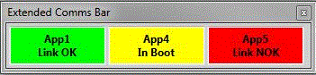
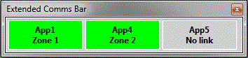
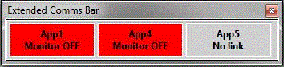
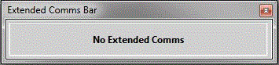

# Extended Comms Bar

To show, hide or move the Extended Comms Bar see [Tool and Information Bars](index.md).

The Extended Comms Bar has an indicator for each sub-unit connected to the main unit, defined within its own Application. Each indicator shows the Application name and the sub-unit status.

An indicator is defined within an Application by the system constant **EXTENDED_COMMS_BAR_SUPPORT**, which names a pair of parameters as `online,status`:

- **Online** - The online parameter indicates the online status of the sub-unit.
- **Status** - The status parameter indicates the link status (zone) of the sub-unit.

The indicator shows:

| Text | Meaning | Background |
|---|---|---|
| **Link OK** | The sub-unit is working and can be placed On-Line. | Green |
| **In Boot** | The sub-unit controllers are in Boot mode (Zone 0). | Yellow |
| **Zone 1**, **Zone 2**, **Zone 3** | The sub-unit controllers are in that zone. | Green |
| **Link NOK** | The online parameter indicates that the sub-unit is not working and cannot be placed On-Line. | Red |
| **Monitor OFF** | The ECU is Off-Line. | Red |
| **No link** | The parameters named by the system constant are invalid or cannot be queried. | Grey |

If no Application in the Project defines Extended Comms, the bar shows **No Extended Comms**:

**See also:** [Comms Bar](comms-bar.md); [ECU Control](../../ecu-control/index.md); [Live Tune](../../tuning/live-tune.md)
