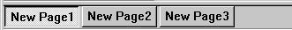
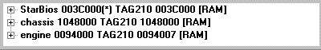
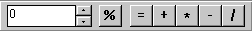
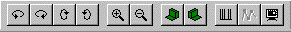
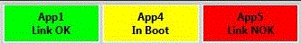
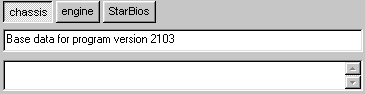

# Tool and Information Bars

## Standard Tool Bar

Commands for file management, editing and [Data Wizard](../../project-management/data-wizard/index.md). See [Standard Tool Bar](standard-tool-bar.md).

## Page Bar

Select a Page to view on the Desktop. See [Pages](../pages/index.md).

## ECU Bar

Information about the program and data versions in System Monitor and in the connected ECU. Only available when a Project is open. See [ECU Bar](ecu-bar.md).

## Maths Bar

Commands to modify [Editable Parameter](../parameters/editable-parameters.md) values. See [Maths Bar](maths-bar.md).

## Map Bar

Commands to manipulate the view in [Graphical Map](../../tuning/graphical-maps/index.md) Windows. See [Map Bar](map-bar.md).

## Comms Bar

Information about the connection to the ECU. See [Comms Bar](comms-bar.md).

## Extended Comms Bar

Information about the connection status of sub-units connected to the ECU. See [Extended Comms Bar](extended-comms-bar.md).

## Notes Bar

Comments and Notes from Data Versions. See [Notes Bar](notes-bar.md).

## Programming Bar

Logs the progress of ECU programming.

## Status Bar

Information about the PC, the unit connection, recording and other status. See [Status Bar](status-bar.md).

## Showing, hiding and moving bars

All Tool and Information Bars except the Status Bar can be shown or hidden from the [View Menu](../menus/view-menu.md) (shortcuts ALT+1 to ALT+9). By default the bars are docked. Docked bars can be moved by dragging any part of the bar that is not text or a button, or by double-clicking.

Floating bars:

- Can be dragged anywhere on the screen. To prevent a floating bar from docking, hold down the CTRL key while dragging.
- Can be closed by clicking . To re-open a bar, select it on the [View Menu](../menus/view-menu.md).
- Can be resized by dragging their borders.
- Can be docked by dragging them to the edge of the Main Window and dropping them when the outline of the bar changes, or by double-clicking the title of the floating bar.

See also [Tool Bar Context Menu](../menus/context-menus/tool-bar-context-menu.md).

The Parameter Explorer can also be docked and its location affects the positioning of the Tool and Information Bars.

**See also:** [Main Window](../main-window.md); [Parameter Explorer](../parameters/parameter-explorer.md); [View Menu](../menus/view-menu.md)
