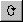
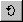
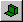
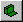
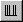
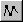

# Map Bar

The Map Bar is only available for Graphical Maps. It has the following commands:

| Button | Command | Description |
|---|---|---|
|  | **Rotate Anti-Clockwise** | Rotates the Map 10 degrees anti-clockwise around the centre of the display (front moves to the right). Only available for [2-axis Maps](../../tuning/2-axis-map-window.md). |
|  | **Rotate Clockwise** | Rotates the Map 10 degrees clockwise around the centre of the display (front moves to the left). Only available for 2-axis Maps. |
|  | **Tilt Forwards** | Rotates the Map 10 degrees forwards around the centre of the display (front moves down). Only available for 2-axis Maps. |
|  | **Tilt Backwards** | Rotates the Map 10 degrees backwards around the centre of the display (front moves up). Only available for 2-axis Maps. See [Rotating a Graphical view](../../tuning/graphical-maps/rotating-a-graphical-view.md). |
|  | **Zoom In** | Increases the size of the view by 50%, centred on the selected value. |
|  | **Zoom Out** | Cancels each Zoom In step in turn. See [Zooming a Graphical view](../../tuning/graphical-maps/zooming-a-graphical-view.md). |
|  | **Slice Y** | Displays the trace on the Y-axis that passes through the selected value. Traces for higher values (behind) are shown in a lighter shade. Only available for 2-axis Maps. |
|  | **Slice X** | Displays the trace on the X-axis that passes through the selected value. Traces for higher values (behind) are shown in a lighter shade. Only available for 2-axis Maps. See [Slice View](../../tuning/graphical-maps/slice-view.md). |
|  | **Breakpoint Spacing** | When on, the axis breakpoints are spaced in proportion to their values. When off, they are spaced evenly whatever their values. See [Breakpoint Spacing](../../tuning/graphical-maps/breakpoint-spacing.md). |
|  | **Select All** | Selects all the values of the selected Parameter. Only available for [1-axis Maps](../../tuning/1-axis-map-window/1-axis-map.md). |
|  | **View Mode** | Steps through all the display modes available for that type of Window. |

**See also:** [Tool and Information Bars](index.md); [Graphical Maps](../../tuning/graphical-maps/index.md)
