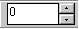
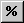

# Maths Bar

The default location for the Maths Bar is docked at the top of the Main Window. The Maths Bar buttons perform simple mathematical operations on the selected value(s) of an Editable Parameter.

You can use all the keyboard maths keys when the Constant text box has focus. The shortcut keys can be used when the Constant text box does not have focus. When one or more values are selected in an Editable Parameter, typing a number overwrites the value in the Constant text box and moves focus to the Maths Bar.

The Percent setting and the value in the Constant text box are retained for each Window.

In the following descriptions, the number entered in the Constant text box is represented by *n*.

| Button | Description | Shortcut |
|---|---|---|
|  | Enter the constant *n* to be used in the calculation. | |
|  | When on, the Maths Bar operates in Percent mode. | |
|  | Replaces the selected value(s) with *n*. When Percent is on, replaces each selected value with *n*% of its original value. | ALT+= |
|  | Adds *n* to the selected values. When Percent is on, adds *n*% of the original value to each selected value. | ALT+UP ARROW |
|  | Multiplies the selected values by *n*. When Percent is on, multiplies each selected value by *n*% of its original value. | ALT+RIGHT ARROW |
|  | Subtracts *n* from the selected values. When Percent is on, subtracts *n*% of the original value from each selected value. | ALT+DOWN ARROW |
|  | Divides the selected values by *n*. When Percent is on, divides each selected value by *n*% of its original value. | ALT+LEFT ARROW |

!!! note
    The minus sign is accepted as a character in the Constant text box, so a highlighted number is overwritten. To use – as a command, make sure that the constant is not highlighted.

**See also:** [Changing Parameter Values](../../tuning/changing-parameter-values/index.md); [Editable Parameter](../parameters/editable-parameters.md); [Tool and Information Bars](index.md)
