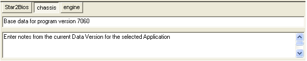

# Notes Bar

To show, hide or move the Notes Bar see [Tool and Information Bars](index.md). The shortcut to show or hide it is ALT+7.

Use the tabs to select an Application. The lower part of the bar shows the Comment and Notes from the current Data Version for the selected Application.

Edit the Comment and Notes as required. Notes and Comments can also be viewed and edited in the Application Properties – Data Version tab.

**See also:** [Application](../../project-management/applications.md); [Developing Data Versions](../../project-management/developing-data-versions/index.md)
