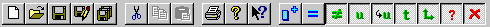
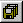
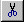
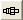
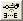

# Standard Tool Bar

The default location for the **Standard Tool Bar** is docked at the top left of the Main Window. To show, hide or move the Tool Bar see [Tool and Information Bars](index.md).

## General controls

| Button | Command | Description |
|---|---|---|
|  | **New** | Opens the File Type Selection dialog box. Select the type of file you want to create. |
|  | **Open** | Opens the File Type Selection dialog box. Select the type of file you want to open. |
|  | **Save** | See [Saving Files](../../project-management/files/saving-files.md) for a description of all save commands. |
|  | **Save As** | See [Saving Files](../../project-management/files/saving-files.md). |
|  | **Save All** | See [Saving Files](../../project-management/files/saving-files.md). |
|  | **Cut** | Copies the selected items to the clipboard and deletes the originals. |
|  | **Copy** | Copies a Window, the selected Measurement Parameters or the values of an Editable Parameter to the clipboard. |
|  | **Paste** | Copies the contents of the clipboard to the selected location. |
|  | **Print** | Prints the selected Window. |
|  | **Help Topics** | Opens the System Monitor Help. |
|  | **Help** | Click the button, then click the button, menu or window you want help with. The appropriate help topic opens. |

## Data Wizard controls

These controls are used with [Data Wizard](../../project-management/data-wizard/index.md). The masking filters are described in [Data Wizard - Parameter Masking](../../project-management/data-wizard/data-wizard-parameter-masking.md).

| Button | Command | Description |
|---|---|---|
|  | **Select Parameters** | Opens the Select Parameters dialog box for the selected Report View or Candidate Data Version window. |
|  | **Equal** | Parameter masking filter. |
|  | **Different Value** | Parameter masking filter. |
|  | **Different Units** | Parameter masking filter. |
|  | **Different Conversion** | Parameter masking filter. |
|  | **Different Data Type** | Parameter masking filter. |
|  | **Different Size** | Parameter masking filter. |
|  | **Different Sensor Calibration** | Parameter masking filter. |
|  | **Absent** | Parameter masking filter. |
|  | **Absent from Edit Buffer** | The parameter is present in the Candidate Data Version but not in the Edit Buffer. |
| | **Locked** | Parameter masking filter for locked parameters. |

**Different Definition** is on the [Data Wizard Menu](../menus/data-wizard-menu.md) but not on the Tool Bar.

## Message logging

| Button | Command | Description |
|---|---|---|
|  | **Log IP transactions with unit** | When selected, logs the messages between System Monitor and the unit. The log is written to the location set by the Advanced Setting **Directory for log files**. See [Settings](../settings.md). |

## Modems

| Button | Command | Description |
|---|---|---|
|  | **Enable Modem** | Enables or disables the connection to the modem comms server selected in the [Project Connections](../../project-management/projects/properties/connections.md) dialog box. When a modem is enabled, the link status to the modem server is shown in the [Comms Bar](comms-bar.md) in place of the Live Updates status. |
|  | **Auto enable modem when no ethernet link** | When selected (button in), modem comms are automatically enabled when the Ethernet link is lost. |

## Synchronisation

| Button | Command | Description |
|---|---|---|
|  | **Unit Status** | Opens the [Unit Status](../../ecu-control/unit-status.md) dialog box. View which files have been loaded into the Edit Buffer and the unit, and synchronise them if required. |
|  | **Sync Unit to System Monitor** | Synchronises the program versions, data versions and configuration files on the unit to those in System Monitor. |
|  | **Sync System Monitor to Unit** | Synchronises the program versions, data versions and configuration files in System Monitor to those on the unit. |

**See also:** [Edit Menu](../menus/edit-menu.md); [File Menu](../menus/file-menu.md); [Data Wizard](../../project-management/data-wizard/index.md)
