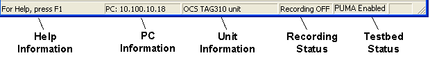

# Status Bar

The Status Bar is located at the bottom of the Main Window and cannot be moved or hidden.

From left to right, the Status Bar shows:

| Area | Description |
|---|---|
| **Help information** | A short description of the menu item or button under the mouse pointer. |
| **Configuration API** | Shown when the [Configuration API](../../configuration-api/index.md) is configured: its address (`API: https://host:port`) followed by **ON**, **OFF**, **NO CERT** or **NOT FOUND**. Right-click this area to open a menu with **Configuration API Start**, **Configuration API Stop** and **Configuration API Reset**. |
| **PC information** | The IP address of the computer running System Monitor. |
| **Unit information** | The Unit name (see [Unit Definition](../../project-management/projects/creating-a-project/car-definition.md)) or connection type. |
| **Recording status** | **Recording ON**, **Recording OFF** or **Trigger pending** (the ECU is On-Line and the Live Logging start trigger is active). See [Live Logging – Recording](../../data-acquisition/logging/live-logging/recording.md). |
| **Testbed status** | **PUMA Enabled** when the [Testbed Link](../../testbed-operation/testbed-link.md) is enabled; otherwise blank. |
| **Pot Board status** | **VE-80** or **VE-81** when a Pot Board is attached; otherwise blank. See [Adjustment Board Control](../../tuning/adjustment-board-control/adjustment-board-control.md). |

**See also:** [ECU Control](../../ecu-control/index.md); [Live Logging](../../data-acquisition/logging/live-logging/index.md)
