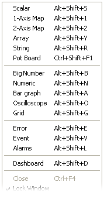

# Creating Empty Windows

Select **Desktop** > **Window** to open the Window sub-menu, then select the type of Window to create. The new Window is created on the current Page.

| Command | Creates |
|---|---|
| **Scalar** (ALT+SHIFT+S) | A [Scalar](../../../tuning/scalar-window.md) window. |
| **1-Axis Map** (ALT+SHIFT+1) | A [1-axis map](../../../tuning/1-axis-map-window/1-axis-map.md) window. |
| **2-Axis Map** (ALT+SHIFT+2) | A [2-axis map](../../../tuning/2-axis-map-window.md) window. |
| **Array** (ALT+SHIFT+Y) | An [Array](../../../tuning/array-window.md) window. |
| **String** (ALT+SHIFT+R) | A [String](../../../tuning/string-window.md) window. |
| **Pot Board** | A window for editing Pot Board parameters. See [Adjustment Board Control](../../../tuning/adjustment-board-control/adjustment-board-control.md). |
| **Big Number** | Listed but always unavailable. See [Big Number](../../../data-display/numeric-display/big-number.md). |
| **Numeric** (ALT+SHIFT+N) | A [Numeric](../../../data-display/numeric-display/numeric.md) window. |
| **Bar graph** (ALT+SHIFT+A) | A [Bar Graph](../../../data-display/bar-graph-display/bar-graph.md) window. |
| **Oscilloscope** (ALT+SHIFT+O) | An [Oscilloscope](../../../data-display/oscilloscope-display/oscilloscope.md) window. |
| **Grid** (ALT+SHIFT+G) | A [Grid](../../../data-display/grid-display/grid.md) window. |
| **Dial Gauge** (ALT+SHIFT+U) | A [Dial Gauge](../../../data-display/dial-gauge-display.md) window. |
| **Error** (ALT+SHIFT+E) | An [Errors](../../../data-display/other-displays/errors/index.md) window. |
| **Event** (ALT+SHIFT+V) | An [Events](../../../data-display/other-displays/events/index.md) window. |
| **Alarms** | An [Alarm](../../../data-display/other-displays/alarms/index.md) window. |
| **Signal Sampling** (ALT+SHIFT+I) | A [Signal Sampling](../../../data-display/signal-sampling-display.md) window. |
| **Dashboard** | A Dashboard window to configure the [PCU-400 Display Unit](../../../pcu-dashboard-configuration/pcu-400-display-unit.md). Only available when the main unit is a PCU400 and no Dashboard window is already open. |
| **Grid from Import...** | A Grid window created from a Grid View Import file (`.xml`) previously exported from a Grid window. |

!!! note
    The menu labels show CTRL+SHIFT+F1 for **Pot Board**, ALT+SHIFT+L for **Alarms** and ALT+SHIFT+D for **Dashboard**, but these keys do not create those Windows: CTRL+SHIFT+F1 opens the Pot Board configuration, ALT+SHIFT+L does nothing and ALT+SHIFT+D clears the display offsets on the Page. See [Keyboard Operation](../../keyboard-operation.md).

A new Window cannot be created on a locked Page.

To add Parameters to the Window, see [Selecting parameters to Edit or Display](../../parameters/selecting-parameters/selecting-parameters-to-edit-or-display.md).

The rest of the Window sub-menu (**Close**, **Show Column Headings**, **Lock Window**, **Properties**, **Cascade** and **Tile**) is described in [Using Windows](../using-windows/index.md).

**See also:** [Editable Parameters](../../parameters/editable-parameters.md); [Measurement Parameters](../../parameters/measurement-parameters.md)
