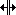
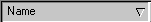

# Columns in Tabular Windows

The following Windows have a tabular display:

- [Scalar](../../../tuning/scalar-window.md)
- [String](../../../tuning/string-window.md)
- [Numeric](../../../data-display/numeric-display/numeric.md)
- [Grid](../../../data-display/grid-display/grid.md)

## Sizing columns

In these Windows the columns can be resized.

**With the mouse:** Place the mouse pointer on the right border of the column header so that the resize cursor  appears. Double-click to fit the column width to the text automatically, or drag the border to a new width.

A column can be hidden by reducing its width to nothing. To re-open it, place the mouse pointer on the border of the column header where the column is hidden, move the pointer slightly to the right until it changes to , and drag the column border to open the column.

**With the keyboard:** Press and release TAB, then use the left or right cursor key to cycle through the column headings. Use the left and right cursor keys to move the right border of the column.

!!! note
    The width of some columns, such as Value columns, cannot be changed.

## Sorting Parameters

Parameters can be sorted in all these Windows except Grid Windows.

**With the mouse:** Click a column heading to sort all the parameters in the Window into the alphanumeric order of the items in that column. Click again to reverse the order.

**With the keyboard:** Press and release TAB, then use the left or right cursor key to cycle through the column headings. Press ENTER to sort the parameters by that column. Press ENTER again to reverse the order.

An arrow in the column heading shows that the column is sorted, and the direction:

| Symbol | Order |
|---|---|
|  | Alphanumeric order: 0123…XYZ |
|  | Reverse alphanumeric order: ZYX…3210 |

**See also:** [Using Windows](index.md)
