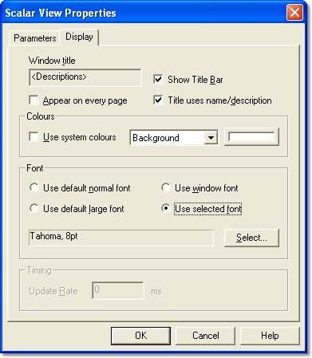

# Window Properties – Display tab

The Display tab of the Window Properties dialog box controls the appearance of the Window. The example below is for a Numeric Window; the tab is common to all Windows.

- **Window title** - The title displayed in the title bar. You can edit it when **Title uses name/description** is not selected. If the box is empty, the title bar shows the type of Window (for example Numeric or Scalar). If the Window was created from a Group in Parameter Explorer, the Group Name or Description, or both, is used as the title.
- **Show Title Bar** - When selected, the Window title bar is displayed. If the title bar is hidden, use ALT+- to open the System Menu. Also on the [Window System Menu](../../menus/window-system-menu.md).
- **Appear on every page** - When selected, the Window is displayed on every Page. When not selected, the Window is displayed only on the Page on which it was created.
- **Title uses name/description** - When selected, the title bar shows the [Name and Description](../../parameters/names-descriptions-and-groups.md) of the Parameter in the Window. Not available for Windows that can display more than one Parameter.

!!! note
    Windows created by [Data Wizard](../../../project-management/data-wizard/index.md) always appear on every Page.

## Colours

**Use system colours** - When selected, the Window uses the default colours. When not selected, you can choose the colours for the various parts of the display: select an item from the drop-down list, then click the colour button to choose a colour. The colours apply only to this Window.

## Font

Select the font used to display text in the Window. The row height is adjusted automatically to suit the font; the column width may need to be adjusted manually.

- **Use default normal font** - Text is displayed in MS Sans Serif 8pt.
- **Use default large font** - Text is displayed using a font 4 times larger than the default font.
- **Use window font** - Text is displayed using the Window Font selected in the [Fonts](../../desktop/fonts.md) dialog box.
- **Use selected font** - Text is displayed using the font shown in the box. Click **Select...** to choose the font.

## Timing

**Update Rate** - How often, in milliseconds, the Window display is refreshed when the ECU is On-Line. This rate is independent of the rate at which data is acquired from the ECU and logged to disk. The default values are:

| Window | Default update rate (ms) |
|---|---|
| Numeric | 700 (100 if the unit supports CVRR) |
| Grid | 700 (100 if the unit supports CVRR) |
| Bar Graph | 200 |
| Oscilloscope | 100 |
| Dial Gauge | 30 |
| Signal Sampling | 200 |
| Error | 1000 |
| Event | 1000 |
| 1-axis Map, 2-axis Map | 200 |
| Read RAM | 200 |
| Scalar, Array, String | Not applicable |

A Numeric, Grid or Bar Graph Window that updates at a slower rate than the current acquisition rate does not display all acquired values (although all acquired values are still logged to disk). An Oscilloscope or Error Window that updates at a slower rate than the current acquisition rate displays all values acquired since the last update.

A Measurement Window that updates at a faster rate than the current acquisition rate displays the value acquired at the last sample. The speed of update of measurement displays depends on the processing power and memory of the PC and on other applications running. Specifying unnecessarily high update rates can reduce the performance of the system.

**See also:** [Window Properties](window-properties.md); [Fonts](../../desktop/fonts.md)
